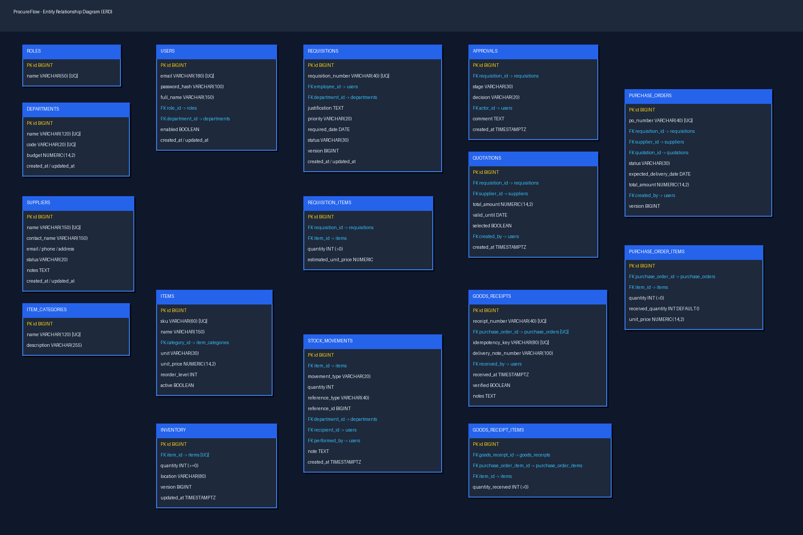

# ProcureFlow Backend

ProcureFlow is a centralized procurement and inventory management system built with Java 21 and Spring Boot 3. It orchestrates the end-to-end purchasing lifecycle: purchase requisitions, multi-stage approval workflows, supplier quotation comparisons, purchase order issuance, transactional goods receiving with duplicate protection, inventory tracking, and analytical reporting.

---

## Tech Stack

| Layer | Technology |
|---|---|
| Language / Runtime | Java 21 (Eclipse Temurin) |
| Framework | Spring Boot 3.3.5 |
| Web API | Spring Web (REST controllers) |
| Persistence | Spring Data JPA (Hibernate) |
| Security | Spring Security + JWT (HS256) |
| Database | PostgreSQL 16 |
| Migrations | Flyway |
| API Documentation | OpenAPI 3 / Swagger UI (`springdoc-openapi-starter-webmvc-ui`) |
| Validation | Jakarta Bean Validation |
| Build Tool | Apache Maven |
| Containerization | Docker & Docker Compose |

---

## Architecture & Database Model

The database schema and entity relationships are modeled with full relational constraints, indexes, sequences, and optimistic/pessimistic locking.



A high-resolution ERD is available at [docs/erd.png](docs/erd.png).

---

## Seeded Demo Accounts

All demo accounts have password: `password123`.

| Email | Role | Department | Purpose |
|---|---|---|---|
| `admin@procureflow.com` | `ADMIN` | IT | Full administrative access |
| `manager@procureflow.com` | `DEPARTMENT_MANAGER` | IT | Requisition review & approval |
| `employee@procureflow.com` | `EMPLOYEE` | IT | Create & submit requisitions |
| `finance@procureflow.com` | `FINANCE_OFFICER` | Finance | Budget check & financial approval |
| `procurement@procureflow.com` | `PROCUREMENT_OFFICER` | Procurement | Quotations & Purchase Orders |
| `storekeeper@procureflow.com` | `STORE_KEEPER` | Warehouse & Logistics | Goods receipt & stock management |

---

## Quick Start & Running Locally

### Option 1: Docker Compose (Recommended)

1. Copy the environment configuration:
   ```bash
   cp .env.example .env
   ```
2. Start all services (PostgreSQL and backend API):
   ```bash
   docker compose up --build
   ```
3. The API and Swagger UI will be accessible at:
   - **Swagger UI:** [http://localhost:8080/swagger-ui.html](http://localhost:8080/swagger-ui.html)
   - **OpenAPI JSON Spec:** [http://localhost:8080/v3/api-docs](http://localhost:8080/v3/api-docs)

### Option 2: Local Maven with Existing PostgreSQL

1. Ensure PostgreSQL is running on port 5432 with database `procureflow` and user `procureflow` (password `change-me`).
2. Run database migrations:
   ```bash
   mvn flyway:migrate -Dflyway.url=jdbc:postgresql://localhost:5432/procureflow -Dflyway.user=procureflow -Dflyway.password=change-me
   ```
3. Run the Spring Boot application:
   ```bash
   mvn spring-boot:run
   ```

---

## Testing

Run automated unit and integration tests:
```bash
mvn clean test
```

---

## Key Features & Acceptance Verification

1. **Multi-Stage Approval Workflow:**
   `DRAFT` -> `SUBMITTED` -> `MANAGER_APPROVAL` -> `FINANCE_APPROVAL` -> `PROCUREMENT` -> `ORDERED` -> `RECEIVED` -> `COMPLETED` (or `REJECTED`).
   Enforced via strict state machine in `RequisitionWorkflowService`. Every decision records an immutable audit log.
2. **Critical Acceptance Scenario - Transactional Receiving:**
   - Single atomic transaction updating PO items, inventory balances, and stock movements.
   - Pessimistic write locking on the Purchase Order (`@Lock(PESSIMISTIC_WRITE)`).
   - Idempotency key protection via `Idempotency-Key` header with original receipt returned on replay.
   - Quantity guards preventing over-receipt.
3. **Role-Based and Record-Level Authorization:**
   Method-level security with `@PreAuthorize` combined with service-level record filtering.
4. **Reports & Dashboard:**
   Expenditure analytics, requisitions breakdown, inventory valuation, and supplier fulfillment statistics.
